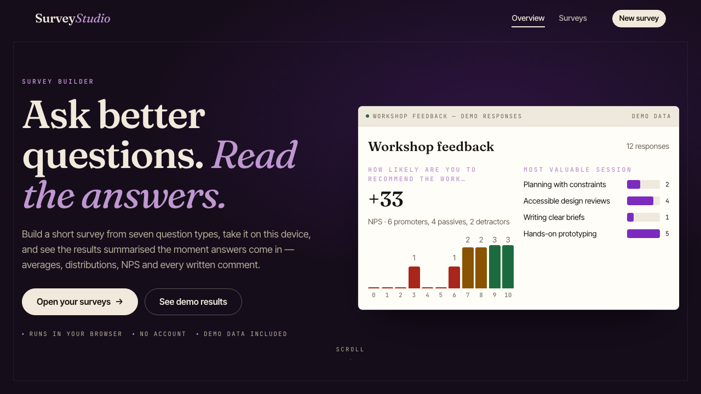
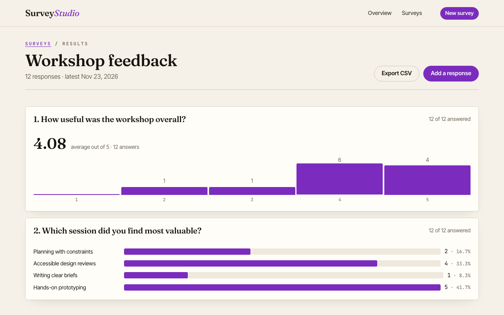
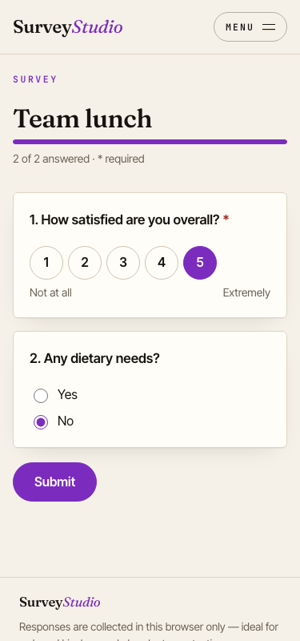

# Survey Studio

Build a short survey from seven question types, collect responses on this device (a workshop laptop, a kiosk, or testing before you send a real survey), and read the results question by question — averages, distributions, an NPS score and every written comment — with CSV export.

**Live demo:** [https://survey-studio-app.vercel.app/](https://survey-studio-app.vercel.app/) — runs entirely in your browser; demo data is fictional and labelled.



| Results | Mobile survey |
| --- | --- |
|  |  |

## Run it

```bash
npm install
npm run dev        # http://localhost:5215
npm test
npm run build
npm run test:e2e   # Playwright smoke test (npm run e2e:install once if Chromium is missing)
```

## Main workflow

1. The app opens with a labelled **demo survey** (workshop feedback, six question types, twelve fictional responses) and a draft. **Surveys → Clear demo surveys** removes them.
2. **Create survey** → the builder: title, introduction, then questions (short answer, paragraph, single choice, checkboxes with an optional selection limit, rating 1–5, likelihood 0–10, yes/no) with help text and a required flag. Reorder or delete questions.
3. **Open for responses** checks every question first. A draft can still be previewed without saving answers.
4. **Take survey** → progress bar, inline validation with a summary, keyboard-friendly radio and checkbox controls, and a thank-you screen ready for the next person.
5. **Results** → per question: choice bars with counts and percentages, rating average with a distribution, NPS with promoters/passives/detractors, and written answers newest first. **Export CSV** gives one row per response.

## Rules

- Choice questions need at least two distinct options; checkbox limits must be between 0 (no limit) and the number of options.
- Checkbox percentages are of people who answered that question, so they can add up to more than 100%.
- **NPS** = % scoring 9–10 − % scoring 0–6, from −100 to +100.
- Optional questions left blank are excluded from that question’s totals; “answered” counts are shown per question.

## Design

Shared editorial system: Fraunces display type, Inter Tight interface text, large tap targets for scales, NPS bars coloured by group with a legend, an ink hero whose preview is the real summary components, and a warm paper workspace. Motion is disabled under `prefers-reduced-motion`.

## Tests

- `src/lib/survey.test.ts` — question and answer validation, whole-response validation, choice/checkbox summaries, rating averages, NPS, text ordering, CSV rows, reordering, completion.
- `src/App.test.tsx` — demo results, required-answer and limit validation then saving, draft preview, building and opening a survey.
- `e2e/smoke.spec.ts` — landing, build and open a survey, take it with reload persistence, results, CSV download, plus 375px layout checks.

## Limitations

- No shareable link — responses are only collected on the device the app is open on.
- No branching logic or file uploads.

## Future improvements

- Conditional questions; importing responses from a CSV gathered elsewhere.

## Licence

MIT — see [LICENSE](LICENSE).
